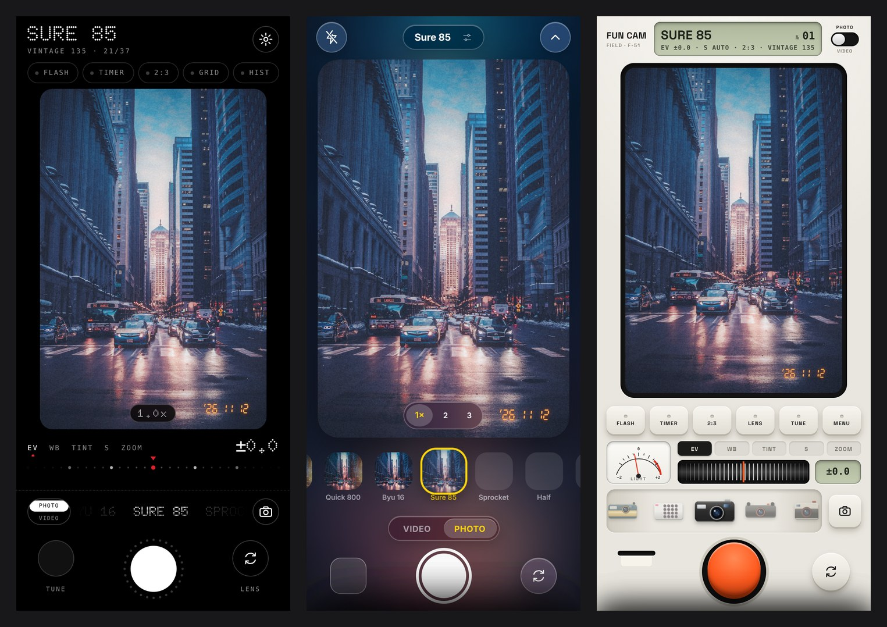
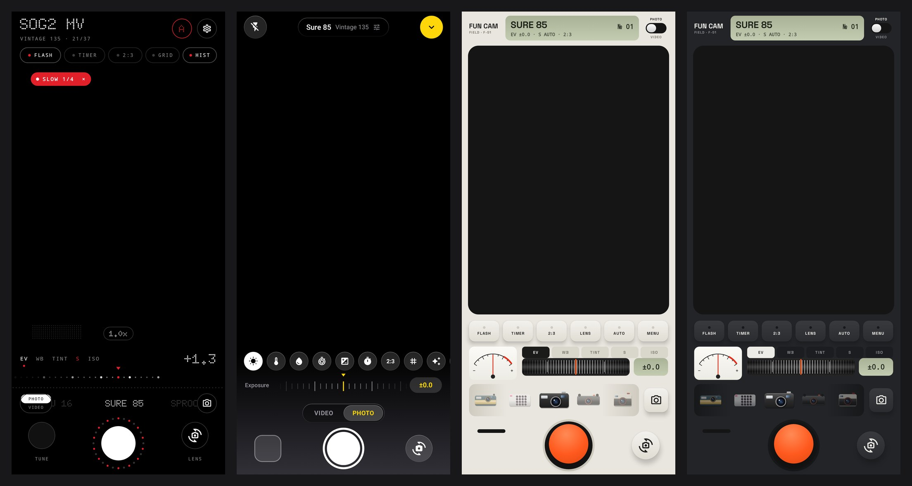
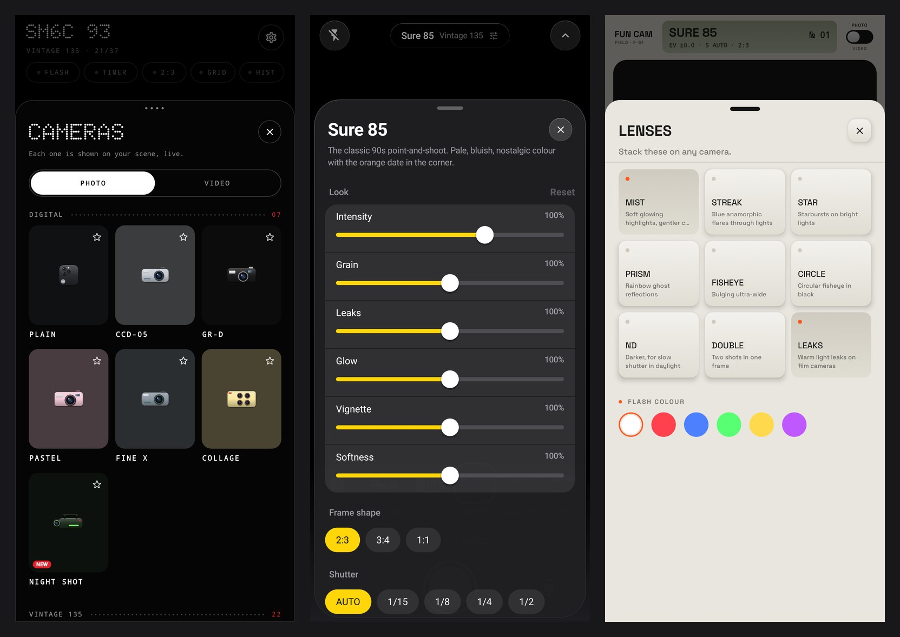

# FUN CAM

A free, open-source retro film camera for **Android** (and the iPhone, as a Safari web app).
51 film cameras with live looks, slow-shutter video, lenses and a darkroom. Everything is
included: no subscriptions, no ads, no tracking.

FUN CAM is an original app inspired by the vintage-camera app genre. All camera names, looks,
icons and code are its own.

## v0.4: one engine, four interfaces



The same camera engine now comes in four separate apps. They install side by side, so you can
keep all of them and pick the one you like.

> **On the web, only GLASS is published for now** (the owner's choice). The DOT and FIELD Safari
> links below are not live; their APKs are. The deploy step in `.github/workflows/web.yml` leaves
> them out, and GitHub Pages deploys from the branch `claude/dreamy-gauss-27k7dh`.

| Edition | What it is | Android APK | iPhone / Safari |
|---|---|---|---|
| **DOT** | Monochrome, dot-matrix type, one red accent. The camera name is the headline, and the shutter sits in a ring of 28 dots that counts down and pulses. | `FUN-CAM-DOT.apk` | [open](https://slaymore99.github.io/DAZZ-CAM/dot/) |
| **GLASS** | Translucent, rounded, calm. A strip of every film look rendered live on your scene, a control tray, and a background tinted by what the lens sees. | `FUN-CAM-GLASS.apk` | [open](https://slaymore99.github.io/DAZZ-CAM/glass/) |
| **FIELD** | A pocket instrument in a bone (or graphite) body: keys that travel, an LCD, a knurled thumbwheel, a light-meter needle and one orange shutter key. | `FUN-CAM-FIELD.apk` | [open](https://slaymore99.github.io/DAZZ-CAM/field/) |
| **Classic** | The v0.3 interface with the camera wheel, kept as it was (original 42 cameras). | `FUN-CAM.apk` | [open](https://slaymore99.github.io/DAZZ-CAM/) |

- **All APKs:** https://github.com/SLAYmore99/DAZZ-CAM/releases/tag/latest

Design references: DOT follows the discipline of Nothing OS (type system, micrographics, one
accent). GLASS follows the iOS Camera (viewfinder first, progressive disclosure, a tray for
less-used controls). FIELD follows hardware instruments in the Braun / Teenage Engineering
tradition (physical controls, one colour, honest labels). Behaviour and principles are
borrowed; every icon, layout and line of code is FUN CAM's own.

### How to install (Android)

1. Open https://github.com/SLAYmore99/DAZZ-CAM/releases/tag/latest on your phone.
2. Download `FUN-CAM-DOT.apk`, `FUN-CAM-GLASS.apk` and `FUN-CAM-FIELD.apk`.
3. Tap each file and allow "install from this source". Three apps appear: FUN CAM Dot, FUN CAM
   Glass and FUN CAM Field.
4. To update an edition later, uninstall that edition first, then install the new APK. Each
   build is signed with a fresh test key, so Android won't install it over the old one.

### How to install (iPhone)

1. Open one of the Safari links above.
2. Tap Share, then "Add to Home Screen".
3. Open it from the Home Screen and allow the camera.

### What every new edition can do

- **One gesture language on the viewfinder:** tap to focus, press and hold to lock focus and
  exposure (Android), drag up or down for exposure, swipe sideways for the next camera, pinch
  to zoom.
- **A dial with detents** for exposure, warmth, tint, shutter, ISO (Android), zoom and frame
  rate. It has momentum, ticks under your finger, and every value has a visible way back to
  automatic (plus one "Auto" control that resets everything).
- **Photo / Video switch** that remembers the last camera you used in each mode.
- **Live look previews:** the camera list shows every film rendered on the scene in front of
  you, not a stock thumbnail.
- **Favourites:** star a camera and it moves to the front.
- **Customize** per camera (intensity, grain, leaks, glow, vignette, softness, frame shape),
  one tap from the main screen in every edition.
- **Slow shutter on every camera**, with a badge in the viewfinder and a coloured shutter ring
  whenever it is on. Tap the badge to turn it off.
- **Grid, horizon level and live histogram** (FIELD shows a light-meter needle).
- **Clear capture feedback:** each edition has its own shutter animation (a screen of dots, a
  quick dim, two mechanical blades), haptics on state changes, and an unmistakable recording
  state with a timer.

### Engine v4 (the film looks)

- **Film highlight shoulder:** bright areas roll off softly instead of clipping.
- **Wide veiling glow and far halation:** a second, much wider blur gives lights real "air"
  and the red halo of cinema film.
- **Mist and Streak lenses:** a black-mist diffusion filter and blue anamorphic flares, on
  top of Star, Prism, Fisheye, ND, Double exposure and Leaks.
- **Cheap-lens distortion** on disposables and toy cameras, **dust specks and hairs** on film
  stills, **paper texture and chemical edges** on instant prints.
- **9 new cameras (51 total):** Cine 800T, Gold 200, Purple Haze, Bleach, X-Pro, Tintype,
  Night Shot, Neon 800T (video) and Night Shot V (video), with six new film looks written
  for FUN CAM (`tools/make_luts.py`).




### How v0.4 was built (step by step)

1. **Engine v4.** New shader stages in `gl/Shaders.kt` (shared with the web by
   `tools/gen_web_data.py`), a 1/16-size wide blur pass in `FilmPipeline.kt` and `web/gl.js`,
   new `Look` fields, six procedural LUTs and nine cameras. Checked with WebGL contact sheets
   on test photos. The classic edition runs with `Engine.v4 = false`, so it renders as before.
2. **Editions in the build.** `app/build.gradle.kts` has four product flavors (`classic`,
   `dot`, `glass`, `field`), each with its own app id, name and icon. The classic screens
   moved to `app/src/classic/`.
3. **Shared web core.** `web/core.js` (camera, state, capture, video, roll, light meter, look
   previews) and `web/kit.js` (dial, sliders, sheets, panels, viewfinder gestures). Each
   edition is only its own `index.html`, `style.css` and `ui.js` in `web/dot`, `web/glass`
   and `web/field`.
4. **Shared Android kit.** `ui/kit/` holds the skin model, dial, widgets, sheet, panels,
   viewfinder and host. Each edition is one `Edition.kt` in `app/src/<edition>/`.
5. **Testing without a phone.** Web: Playwright with a fake camera walks through every panel,
   takes a photo and records a video in each edition. Android: Robolectric + Roborazzi render
   the real Compose screens to PNG (`app/build/screens/`), since the cloud has no emulator.
6. **Shipping.** CI builds, tests and lints all four apps and uploads four APKs to the
   `latest` release; GitHub Pages serves the web editions.

**Not tested on a real phone yet.** The Android screens were rendered on the JVM and the web
editions ran in desktop Chromium with a fake camera. Live camera, haptics, focus lock, the
level and performance still need a real device.

## Features

- **Live film viewfinder**: every look renders in real time on the GPU (OpenGL ES 3). What you
  see is what you get.
- **51 cameras (37 photo, 14 video)**, each recreating a classic camera or film (the classic edition keeps the original 42). See
  [`docs/CAMERAS.md`](docs/CAMERAS.md) for the research behind each one.
  - **Digital:** Plain, CCD-05, GR-D, Pastel, Fine X, Collage
  - **Vintage 135:** Range, GR Mono, T2, Fade 35, T4 Super, 3D Wiggle, Slide NE, Fun Saver,
    Infra, SLR Classic, Simple, Quick 800, Byu 16, Sure 85, Sprocket, Half, Slide
  - **Vintage 120:** TLR, Toy 120, Six7, Kiev
  - **Instant:** Insta Mini, Insta Mono, Insta SQ
  - **Video:** Plain V, Classic V, 16 Mil, Super 8, VHS, Kino, Insta V, Fun Saver V, Handycam,
    Glow V, Projector, Dream Blur
- **Real film colour**: 3D LUTs built from film-emulation data (Portra, Superia, Kodachrome,
  Ektachrome, Velvia, Instax-style FP-100C, Polaroid…), plus FUN CAM's own CCD, VHS, camcorder
  and colour-infrared looks.
- **Film character**, rendered in four passes:
  - **Grade:** lens, flash and white balance, then the film LUT.
  - **Bloom:** a real Gaussian blur.
  - **Halation:** red glow around highlights.
  - **Composite:** organic light leaks, film grain built on an integer hash (no line artefacts),
    soft corners, gate weave, flicker, dust and hairs, VHS chroma bleed and tracking noise.
- **Frames**: instant prints, 120 rebates, 35mm sprocket strips and slide mounts.
- **Date stamps**: a glowing 7-segment orange film date (`'26 11 10`), a digicam date,
  camcorder date/time and a VHS `PLAY` overlay.
- **Slow-shutter video and long exposures**: Dream Blur and Manual V/P blend frames on the GPU
  to simulate shutters up to 1 second. You can also set ISO and frame rate (1–30 fps). Phones
  that support manual sensor control also use a real longer exposure.
- **Multi-shot cameras**:
  - half-frame pairs
  - a 4-shot collage card
  - a 16-lens 4×4 flip-book
  - a 4-lens 3D wiggle clip
- **Accessories that stack on any camera**: Fisheye W (full-frame), Fisheye C (circular),
  prism, star, ND, coloured flash gels, double exposure and light leaks on/off.
- **Controls**: flash/torch, 3s/10s timer, grid, aspect ratios per camera, exposure,
  temperature, tint, zoom presets and pinch zoom, tap to focus, front/back camera, preview
  stabilization, and mic on/off.
- **Import**: develop any photo from your gallery with a camera's look.
- **Darkroom**: every shot keeps a private "negative", so you can re-develop it later with
  another camera, exposure or white balance.
- **Saving**: photos go to `Pictures/FUN CAM` and videos go to `Movies/FUN CAM`.

## Install

Download `FUN-CAM.apk` from the latest GitHub Actions run (**Actions → Build FUN CAM APK →
Artifacts**) or from a Release, then open it on your phone and allow installing from this
source. You need Android 8.0 or later with OpenGL ES 3.

## iPhone (test version)

`web/` holds a web-app version of FUN CAM that runs in Safari and can be added to the Home
Screen. It uses the same shader and cameras as the Android app. See `web/README.md`.

## Build

```bash
./gradlew assembleRelease     # app/build/outputs/apk/release/app-release.apk
./gradlew testDebugUnitTest lintDebug
```

You need JDK 17+ and the Android SDK (platform 35).

## How it works

```
CameraX Preview ─▶ SurfaceTexture (OES)
        │
        ▼
 input pass: rotate/mirror + accumulate frames   (slow shutter = exponential frame blend)
        │
        ▼
 film pass: one uber-shader driven by each camera's Look recipe
        ├─▶ viewfinder (SurfaceView)
        └─▶ MediaCodec H.264 surface at the camera's frame rate (+ AAC mic) ─▶ MP4
ImageCapture (full res) ─▶ StillProcessor (same shader, offscreen) ─▶ JPEG
```

The main source files:

- `app/src/main/java/com/funcam/app/model/Cameras.kt`: the camera roster. Each camera is plain
  data, so adding one is easy.
- `gl/Shaders.kt`: the film shader.
- `gl/FilmRenderer.kt`: the live GL thread.
- `gl/StillProcessor.kt`: full-resolution developing.
- `video/Encoders.kt`: the recorders.
- `ui/`: the Compose UI.

## License

The code is MIT. The film LUTs are CC BY-SA 4.0 (see [`THIRD_PARTY.md`](THIRD_PARTY.md)).
